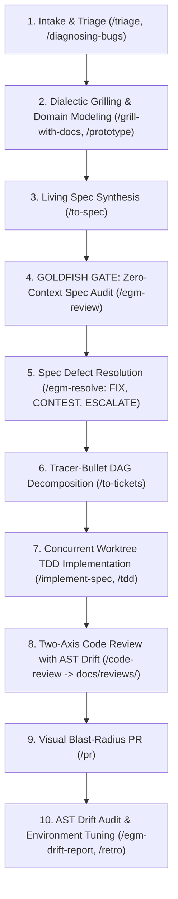

# Agentic-Driven Development: Skills & Agents Backlog

A dedicated hub and backlog repository for **AI Agent Skills, Subagent Orchestrations, and Autonomous Engineering Workflows** built for **Google Antigravity (`agy`) and Gemini CLI**.

This repository is maintained as a central catalog, testing ground, and development backlog for agent capabilities, reusable engineering runbooks, and domain-driven design workflows. It combines the **Matt Pocock End-to-End Execution Lifecycle** (deep modules, strict TDD, tracer-bullet DAGs, and worktree concurrency) with the **Google Elephant-Goldfish Model (EGM)** (upstream zero-context Goldfish spec reviews, anti-sycophancy guardrails, architectural neutrality, and AST drift detection).

---

## 🎯 Repository Purpose

The primary objective of this repository is to curate, maintain, test, and document production-grade skills and steering guidelines for autonomous coding agents:

1. **Skills Catalog**: Hosts a verified collection of modular Antigravity skills in [`.agents/skills/`](.agents/skills/), covering everything from requirements grilling and zero-context spec stress-testing to automated TDD, AST drift detection, and two-axis code reviews.
2. **Agent Steering & Subagent Roster**: Establishes universal guidelines in [`AGENTS.md`](AGENTS.md) and provides **specialized subagents** (`triage-agent`, `architect`, `researcher`, `implementer`, `debugger`, `reviewer`) under [`.agents/agents/`](.agents/agents/).
3. **Google EGM Integration**: Integrates the **Elephant-Goldfish Model** (`egm.dev`), enforcing zero-context adversarial spec audits (`/egm-review`), evidence-backed triage (`/egm-resolve`), and post-implementation AST drift auditing (`/egm-drift-report`).
4. **Execution Runbooks & Guides**: Provides clear visual architecture, sequence diagrams, and real-world walkthrough scenarios in [`illustration.md`](illustration.md).

---

## 🏗️ Repository Structure

```
├── .agents/
│   ├── agents/           # Specialized autonomous subagents
│   │   ├── triage-agent/ # Issue/PR intake, bug repro & agent briefs
│   │   ├── architect/    # Grilling, ADRs, interface contracts & ticket DAGs
│   │   ├── researcher/   # Read-only exploration & cited documentation search
│   │   ├── implementer/  # Strict TDD construction & deep module refactoring
│   │   ├── debugger/     # 6-phase scientific hypothesis testing & bug isolation
│   │   └── reviewer/     # 2-axis independent review (Standards + Spec with AST drift)
│   └── skills/           # 27 Antigravity engineering & productivity skills
│       ├── ask-matt/                       # Workflow router & navigator
│       ├── code-review/                    # 2-axis review (Standards + Spec) -> docs/reviews/
│       ├── codebase-design/                # Deep module design & interface seams
│       ├── diagnosing-bugs/                # 6-phase hypothesis & instrumentation loop
│       ├── domain-modeling/                # Ubiquitous language, GLOSSARY.md & ADRs (Rule 13)
│       ├── grill-me/                       # Decision tree interview (general)
│       ├── grill-with-docs/                # Grilling + inline ADR & glossary generation
│       ├── handoff/                        # Multi-session context serialization
│       ├── implement/                      # Single-ticket TDD implementation
│       ├── implement-spec/                 # Concurrent subagent DAG implementation
│       ├── improve-codebase-architecture/  # Deepening scan & HTML candidate report
│       ├── pr/                             # High-signal PR generator & blast-radius
│       ├── prototype/                      # Fast throwaway logic & UI exploration
│       ├── research/                       # Primary-source cited technical discovery
│       ├── retro/                          # Session retrospective & AST drift checks
│       ├── setup-matt-pocock-skills/       # Issue tracker & triage initialization
│       ├── tdd/                            # Red-Green-Refactor vertical slice loop
│       ├── teach/                          # Stateful tutoring & missions workspace
│       ├── to-questionnaire/               # Async decision interview for third parties
│       ├── to-spec/                        # Spec synthesizer with Goldfish Review Gate
│       ├── to-tickets/                     # Spec-to-DAG tracer-bullet decomposition
│       ├── triage/                         # 5-state issue & PR triage engine
│       ├── wait-what/                      # Plain-English re-pitch of confusing concepts
│       ├── wayfinder/                      # Epic-scale fog-of-war decision navigation
│       ├── wizard/                         # Interactive bash wizard for manual steps
│       └── writing-for-agents/             # Style guide with anti-glazing & neutrality rules
├── docs/                 # Agentic architecture, security, and reviews (`docs/reviews/`)
├── tasks/                # Skills and agents backlog (`tasks/backlog.md`)
├── specs/                # Specifications for new skills and agent workflows
├── scripts/              # Validation, linting, and installation scripts
├── AGENTS.md             # Core steering instructions for AI agents
├── illustration.md       # Complete visual and operational guide to all skills & agents
└── README.md             # Repository purpose and documentation
```

---

## ⚡ The Unified 10-Step Lifecycle: Idea to Ship



### High-Impact Enhancements:
1. **The Goldfish Gate (`/egm-review` & `/egm-resolve`)**: Never decompose a spec into tickets until an ephemeral, zero-context subagent reads the spec cold, verifies comprehension, and probes edge cases.
2. **Two-Axis Code Review with AST Drift**: [`code-review`](file://.agents/skills/code-review/SKILL.md) audits both **Standards** (Fowler smells) and **Spec** (AST drift: Missing Features, Incomplete Models, Logic Shortcuts, ADR violations). All reports are saved under `docs/reviews/`.
3. **Anti-Sycophancy (Anti-Glazing)**: Absolute ban on flattering adjectives (*"brilliant"*, *"great idea"*), ban on conversational apologies, and critique-first analysis.
4. **Architectural Neutrality (Rule 13)**: When presenting architectural forks or trade-offs, agents present up to 3 defensible options with concrete mechanisms and failure modes without nudging toward a default.

---

## 👥 Specialized Subagent Roster

| Subagent | Role | Bound Skills | When to Use |
| :--- | :--- | :--- | :--- |
| **`triage-agent`** | Pre-Flight & Triage | `triage` | Ingesting issues/PRs, reproducing bugs with scripts, and authoring `AGENT-BRIEF.md`. |
| **`architect`** | System Architecture | `grill-with-docs`, `codebase-design`, `to-spec`, `to-tickets` | Grilling requirements, creating ADRs/glossaries, running Goldfish spec reviews, and decomposing ticket DAGs. |
| **`researcher`** | Read-Only Exploration | `research` | Tracing unfamiliar execution paths, investigating external APIs, and providing cited findings without editing code. |
| **`implementer`** | TDD Construction | `tdd`, `codebase-design` | Building specific tickets using the Red-Green-Refactor cycle across clean, deep module boundaries. |
| **`debugger`** | Root-Cause Analysis | `diagnosing-bugs` | Resolving flaky tests, race conditions, or hard defects via hypothesis isolation and 50-run stress tests. |
| **`reviewer`** | Two-Axis Gatekeeper | `code-review` | Evaluating diffs on Standards (cleanliness/smells) and Spec (AST drift/ADRs), persisting reports to `docs/reviews/`. |

---

## 🚀 How to Use in Your Projects

### 1. Install Google EGM Plugin
Install Google's Elephant-Goldfish Model plugin directly via `agy`:

```bash
agy plugin install https://github.com/google/elephant-goldfish-model
```

### 2. Copy Skills into Your Repository
Copy `.agents` into your target project:

```bash
mkdir -p /path/to/your/project/.agents
cp -r .agents/agents /path/to/your/project/.agents/
cp -r .agents/skills /path/to/your/project/.agents/
```

### 3. Global Machine Installation
Install skills globally into your Antigravity configuration directory:

```bash
mkdir -p ~/.gemini/antigravity-cli/skills ~/.gemini/antigravity-cli/agents
cp -r .agents/skills/* ~/.gemini/antigravity-cli/skills/
cp -r .agents/agents/* ~/.gemini/antigravity-cli/agents/
```

---

## 🚦 Core Skill Workflows At a Glance

| Lifecycle Phase | Primary Agent | Key Skills | Trigger / Command | What It Does |
| :--- | :--- | :--- | :--- | :--- |
| **Intake & Triage** | `triage-agent` | `triage` | `/triage` | Verifies reproducibility and moves issues into ready states |
| **Design & Grilling** | `architect` | `grill-with-docs`, `grill-me` | `/grill-with-docs`, `/grill-me` | Stress-tests requirements; records `GLOSSARY.md` & ADRs neutrally |
| **Spec Synthesis** | `architect` | `to-spec`, `codebase-design` | `/to-spec` | Synthesizes contracts into formal user stories and specs |
| **Goldfish Spec Gate** | Goldfish subagents | `egm-review`, `egm-resolve` | `/egm-review`, `/egm-resolve` | Zero-context adversarial audit before decomposing into tickets |
| **Decomposition** | `architect` | `to-tickets` | `/to-tickets` | Decomposes verified specs into a ticket DAG with blocking edges |
| **Execution** | `implementer` | `implement-spec`, `implement`, `tdd` | `/implement-spec`, `/implement` | Red-Green-Refactor implementation across isolated worktrees |
| **Bug Isolation** | `debugger` | `diagnosing-bugs` | `/diagnosing-bugs` | 6-phase hypothesis testing and 50-run stress verification |
| **Review & Quality** | `reviewer` | `code-review` | `/code-review` | Standards + Spec review with AST drift check; saves to `docs/reviews/` |
| **Delivery & PR** | Primary / `implementer` | `pr` | `/pr` | Formats high-signal PR descriptions with proof & blast radius |
| **Drift Audit & Retro** | Primary Agent | `egm-drift-report`, `retro` | `/egm-drift-report`, `/retro` | AST code-to-spec consistency scan and environment tuning |

For complete diagrams, sequence charts, and real-world scenarios, consult [`illustration.md`](illustration.md).

---

## 🧪 Skill Quality, Verification & Automated Checks

The repository includes automated quality tooling to ensure all skills and subagents stay healthy:

### Automatic Pre-Commit Hook
A Git pre-commit hook runs `python3 scripts/validate_skills.py` automatically at commit time:
- Verifies YAML frontmatter (`name`, `description`, `tools`, `subagent: true`).
- Estimates token costs for progressive disclosure catalogs.
- Verifies all local markdown file links exist on disk.
- Bans deprecated vendor syntax and Claude XML thinking tags.

### Running Tools & Tests Manually
```bash
# Run the skill & agent quality validator
python3 scripts/validate_skills.py

# Run the automated unit test suite
python3 -m unittest discover -s tests -v

# Re-install git hooks on a fresh clone
./scripts/install_hooks.sh
```

---

## 📋 Active Backlog

Check [`tasks/backlog.md`](tasks/backlog.md) for the active roadmap.
