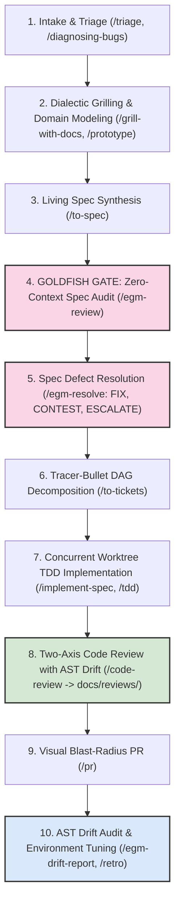

# Agentic-Driven Development: Skills & Agents Backlog

A dedicated catalog and backlog for **AI Agent Skills, Subagent Orchestrations, and Autonomous Engineering Workflows** built for **Google Antigravity (`agy`) and Gemini CLI**.

This repository combines two complementary engineering methodologies:
- **Matt Pocock End-to-End Execution Framework**: Deep modules, test-driven development (TDD), tracer-bullet ticket DAGs, parallel Git worktrees, and two-axis code reviews.
- **Google Elephant-Goldfish Model (EGM)**: Spec-first design with a strict No-Code elephant session, zero-context Goldfish adversarial reviews (`/egm-review`), evidence-backed triage (`/egm-resolve`), and post-merge AST drift detection (`/egm-drift-report`).

---

## Repository Purpose

This repository curates, tests, and documents production-grade skills and steering guidelines for autonomous coding agents:

1. **Skills Catalog**: Hosts 27 modular Antigravity skills in [`.agents/skills/`](.agents/skills/), covering everything from initial requirements grilling to automated TDD and two-axis code reviews.
2. **Subagent Roster**: Defines specialized autonomous subagents (`triage-agent`, `architect`, `researcher`, `implementer`, `debugger`, `reviewer`) under [`.agents/agents/`](.agents/agents/).
3. **Google EGM Integration**: Incorporates upstream specification verification, anti-sycophancy rules, and AST drift detection from the Elephant-Goldfish Model.
4. **Visual Runbooks**: Provides visual architecture, lifecycle flowcharts, and walkthrough scenarios in [`illustration.md`](illustration.md).

---

## Repository Structure

```
├── .agents/
│   ├── agents/           # Specialized autonomous subagents
│   │   ├── triage-agent/ # Issue/PR intake, bug repro & agent briefs
│   │   ├── architect/    # Grilling, ADRs, interface contracts & ticket DAGs
│   │   ├── researcher/   # Read-only exploration & cited documentation search
│   │   ├── implementer/  # Strict TDD construction in isolated worktrees
│   │   ├── debugger/     # 6-phase scientific hypothesis testing & bug isolation
│   │   └── reviewer/     # 2-axis review (Standards + Spec with AST drift)
│   └── skills/           # 27 Antigravity engineering & productivity skills
│       ├── ask-matt/                       # Workflow router & navigator
│       ├── code-review/                    # 2-axis review -> writes to docs/reviews/
│       ├── codebase-design/                # Deep module design & interface seams
│       ├── diagnosing-bugs/                # 6-phase hypothesis & instrumentation loop
│       ├── domain-modeling/                # Ubiquitous language, GLOSSARY.md & ADRs
│       ├── grill-me/                       # Decision tree interview (stateless)
│       ├── grill-with-docs/                # Grilling + inline ADR & glossary generation
│       ├── handoff/                        # Multi-session context serialization
│       ├── implement/                      # Single-ticket TDD implementation
│       ├── implement-spec/                 # Concurrent subagent DAG implementation
│       ├── improve-codebase-architecture/  # Deepening scan & HTML candidate report
│       ├── pr/                             # High-signal PR generator & blast-radius
│       ├── prototype/                      # Fast throwaway logic & UI exploration
│       ├── research/                       # Primary-source cited technical discovery
│       ├── retro/                          # Session retrospective & AST drift checks
│       ├── setup-matt-pocock-skills/       # Issue tracker & triage initialization
│       ├── tdd/                            # Red-Green-Refactor vertical slice loop
│       ├── teach/                          # Stateful tutoring & missions workspace
│       ├── to-questionnaire/               # Async decision interview for third parties
│       ├── to-spec/                        # Spec synthesizer with Goldfish Review Gate
│       ├── to-tickets/                     # Spec-to-DAG tracer-bullet decomposition
│       ├── triage/                         # 5-state issue & PR triage engine
│       ├── wait-what/                      # Plain-English re-pitch of confusing concepts
│       ├── wayfinder/                      # Epic-scale fog-of-war decision navigation
│       ├── wizard/                         # Interactive bash wizard for manual steps
│       └── writing-for-agents/             # Style guide with anti-glazing & neutrality rules
├── docs/                 # Agentic architecture, security, and reviews (docs/reviews/)
├── tasks/                # Skills and agents backlog (tasks/backlog.md)
├── specs/                # Specifications for new skills and agent workflows
├── scripts/              # Validation, linting, and installation scripts
├── AGENTS.md             # Core steering instructions for AI agents
├── illustration.md       # Complete visual and operational guide to all skills & agents
├── LICENSE               # MIT License
└── README.md             # Repository purpose and documentation
```

---

## The 10-Step Engineering Lifecycle

The development workflow proceeds through explicit phase boundaries:



### Step Summary:
1. **Intake & Triage**: Verify bug reports and incoming issues with reproduction scripts (`/triage`).
2. **Grilling & Domain Modeling**: Stress-test requirements, define domain language in `GLOSSARY.md`, and record Architectural Decision Records in `docs/adr/` (`/grill-with-docs`).
3. **Spec Synthesis**: Draft a comprehensive specification in `docs/designs/<feature>.md` (`/to-spec`).
4. **The Goldfish Gate**: Launch a stateless subagent with zero conversation history to stress-test the draft spec cold (`/egm-review`).
5. **Critique Resolution**: Resolve findings using structured triage (`PROPOSE FIX`, `CONTEST`, `ESCALATE`, `DECLINE`) before writing tickets (`/egm-resolve`).
6. **Task Decomposition**: Split the verified spec into tracer-bullet tickets with explicit blocking edges (`/to-tickets`).
7. **Implementation**: Build tickets test-first (Red -> Green -> Refactor) across parallel Git worktrees (`/implement-spec`, `/tdd`).
8. **Two-Axis Code Review**: Evaluate diffs on Standards (repo patterns & Fowler smells) and Spec (AST drift & ADRs), saving reports to `docs/reviews/` (`/code-review`).
9. **Pull Request**: Generate high-signal PR bodies with proof of tests and blast-radius analysis (`/pr`).
10. **Drift Audit & Retro**: Check for AST divergence between code and design docs (`/egm-drift-report`), and tune agent rules and linters (`/retro`).

---

## Core Guidelines & Invariants

### 1. Anti-Sycophancy (Anti-Glazing) Standard
- **Banned Adjectives**: Strict ban on flattering words (*"brilliant"*, *"great idea"*, *"perfect"*, *"excellent"*, *"spot-on"*). Praise adds noise and creates confirmation bias.
- **Banned Apologies**: Strict ban on conversational apologies (*"I apologize"*, *"I am sorry"*). State the corrected technical logic or trade-offs directly.
- **Plain-English Explanations**: Use direct, jargon-free explanations. Avoid promotional words (*"seamless"*, *"robust"*, *"blazingly fast"*).
- **Critique First**: Lead with what is broken, missing, or risky before noting merits.

### 2. Architectural Neutrality (Rule 13)
- The human remains the architectural owner.
- When presenting architectural choices or trade-offs, present up to 3 defensible options with concrete mechanisms, pros, cons, and failure modes without pre-selecting or leading the user.

---

## Specialized Subagent Roster

| Subagent | Role | Bound Skills | When to Use |
| :--- | :--- | :--- | :--- |
| **`triage-agent`** | Pre-Flight & Triage | `triage` | Ingesting issues/PRs, reproducing bugs with scripts, and authoring `AGENT-BRIEF.md`. |
| **`architect`** | System Architecture | `grill-with-docs`, `codebase-design`, `to-spec`, `to-tickets` | Grilling requirements, creating ADRs/glossaries, running Goldfish spec reviews, and decomposing ticket DAGs. |
| **`researcher`** | Read-Only Exploration | `research` | Tracing unfamiliar execution paths, investigating external APIs, and providing cited findings without editing code. |
| **`implementer`** | TDD Construction | `tdd`, `codebase-design` | Building specific tickets using the Red-Green-Refactor cycle across clean, deep module boundaries in worktrees. |
| **`debugger`** | Root-Cause Analysis | `diagnosing-bugs` | Resolving flaky tests, race conditions, or hard defects via hypothesis isolation and 50-run stress tests. |
| **`reviewer`** | Two-Axis Gatekeeper | `code-review` | Evaluating diffs on Standards (cleanliness/smells) and Spec (AST drift/ADRs), persisting reports to `docs/reviews/`. |

---

## How to Use in Your Projects

### 1. Install Google EGM Plugin
Install Google's Elephant-Goldfish Model plugin via `agy`:

```bash
agy plugin install https://github.com/google/elephant-goldfish-model
```

### 2. Copy Skills into Your Repository
Copy `.agents` into your target project root:

```bash
mkdir -p /path/to/your/project/.agents
cp -r .agents/agents /path/to/your/project/.agents/
cp -r .agents/skills /path/to/your/project/.agents/
```

### 3. Global Machine Installation
Install skills globally into your Antigravity configuration directory:

```bash
mkdir -p ~/.gemini/antigravity-cli/skills ~/.gemini/antigravity-cli/agents
cp -r .agents/skills/* ~/.gemini/antigravity-cli/skills/
cp -r .agents/agents/* ~/.gemini/antigravity-cli/agents/
```

---

## Core Skill Workflows At a Glance

| Lifecycle Phase | Primary Agent | Key Skills | Trigger / Command | What It Does |
| :--- | :--- | :--- | :--- | :--- |
| **Intake & Triage** | `triage-agent` | `triage` | `/triage` | Verifies reproducibility and moves issues into ready states |
| **Design & Grilling** | `architect` | `grill-with-docs`, `grill-me` | `/grill-with-docs`, `/grill-me` | Stress-tests requirements; records `GLOSSARY.md` & ADRs neutrally |
| **Spec Synthesis** | `architect` | `to-spec`, `codebase-design` | `/to-spec` | Synthesizes contracts into formal user stories and specs |
| **Goldfish Spec Gate** | Goldfish subagents | `egm-review`, `egm-resolve` | `/egm-review`, `/egm-resolve` | Zero-context adversarial audit before decomposing into tickets |
| **Decomposition** | `architect` | `to-tickets` | `/to-tickets` | Decomposes verified specs into a ticket DAG with blocking edges |
| **Execution** | `implementer` | `implement-spec`, `implement`, `tdd` | `/implement-spec`, `/implement` | Red-Green-Refactor implementation across isolated worktrees |
| **Bug Isolation** | `debugger` | `diagnosing-bugs` | `/diagnosing-bugs` | 6-phase hypothesis testing and 50-run stress verification |
| **Review & Quality** | `reviewer` | `code-review` | `/code-review` | Standards + Spec review with AST drift check; saves to `docs/reviews/` |
| **Delivery & PR** | Primary / `implementer` | `pr` | `/pr` | Formats high-signal PR descriptions with proof & blast radius |
| **Drift Audit & Retro** | Primary Agent | `egm-drift-report`, `retro` | `/egm-drift-report`, `/retro` | AST code-to-spec consistency scan and environment tuning |

For detailed diagrams and practical walkthroughs, see [`illustration.md`](illustration.md).

---

## Skill Quality, Verification & Automated Checks

The repository includes automated verification tooling to ensure skills and subagents remain consistent:

### Automatic Pre-Commit Hook
A Git pre-commit hook runs `python3 scripts/validate_skills.py` automatically at commit time:
- Verifies YAML frontmatter (`name`, `description`, `tools`, `subagent: true`).
- Estimates token costs for progressive disclosure catalogs.
- Verifies that all local markdown file links exist on disk.
- Flags deprecated vendor syntax and Claude XML thinking tags.

### Running Tools & Tests Manually
```bash
# Run the skill & agent quality validator
python3 scripts/validate_skills.py

# Run the automated unit test suite
python3 -m unittest discover -s tests -v

# Re-install git hooks on a fresh clone
./scripts/install_hooks.sh
```

---

## License

This project is licensed under the [MIT License](LICENSE).
