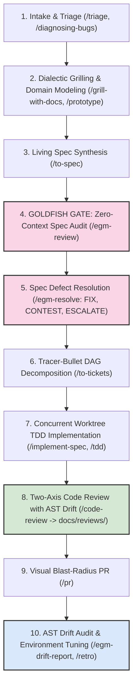
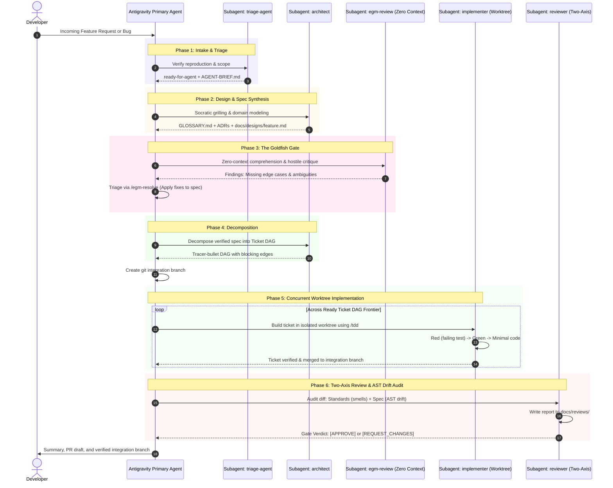

# Antigravity (`agy`) Skills Architecture & Illustration Guide

This guide illustrates the complete engineering framework combining the **Matt Pocock End-to-End Execution Lifecycle** with the **Google Elephant-Goldfish Model (EGM)**. All skills and subagents are curated and optimized specifically for the **Google Antigravity (`agy`) / Gemini CLI** agent environment.

---

## Table of Contents

1. [Architectural Overview](#1-architectural-overview)
2. [The 10-Step End-to-End Development Lifecycle](#2-the-10-step-end-to-end-development-lifecycle)
3. [Antigravity Subagent Orchestration](#3-antigravity-subagent-orchestration)
4. [Master Skill Directory](#4-master-skill-directory)
   - [Phase 1: Exploration, Alignment & Triage](#phase-1-exploration-alignment--triage)
   - [Phase 2: Specification & System Design](#phase-2-specification--system-design)
   - [Phase 3: The Goldfish Review Gate](#phase-3-the-goldfish-review-gate)
   - [Phase 4: Task Decomposition](#phase-4-task-decomposition)
   - [Phase 5: Implementation & Test-Driven Development](#phase-5-implementation--test-driven-development)
   - [Phase 6: Two-Axis Review & Quality Gate](#phase-6-two-axis-review--quality-gate)
   - [Phase 7: Drift Auditing, Retrospective & Delivery](#phase-7-drift-auditing-retrospective--delivery)
   - [Phase 8: Productivity, Communication & Learning](#phase-8-productivity-communication--learning)
5. [In-Depth Skill Breakdown](#5-in-depth-skill-breakdown)
6. [Real-World Walkthrough Scenarios](#6-real-world-walkthrough-scenarios)
   - [Scenario A: Building a Feature from Scratch (Full 10-Step Flow)](#scenario-a-building-a-feature-from-scratch-full-10-step-flow)
   - [Scenario B: Diagnosing and Fixing a Hard Bug](#scenario-b-diagnosing-and-fixing-a-hard-bug)
   - [Scenario C: Architectural Audit and Module Deepening](#scenario-c-architectural-audit-and-module-deepening)
   - [Scenario D: Context Handoff Across Sessions](#scenario-d-context-handoff-across-sessions)

---

## 1. Architectural Overview

In **Antigravity (`agy`)**, skills are modular packages of procedures, patterns, and runbooks located in the workspace under `.agents/skills/<skill-name>/SKILL.md`.

### The Core Architectural Mental Model
- **The Elephant (Persistent Context)**: High-context session holding the repository mental model, domain glossary, and operational constraints. Operates under a **strict No-Code rule** during ideation, grilling, and specification authoring.
- **The Goldfish (Zero-Context Critics)**: Stateless, ephemeral subagents spawned with zero conversation history to stress-test designs cold and prevent confirmation bias.
- **Deep Modules & Seams**: Based on John Ousterhout's *Philosophy of Software Design* ([`codebase-design`](.agents/skills/codebase-design/SKILL.md)): simple interfaces hiding complex implementations, with tests pinned to public boundaries.
- **Strict Test-Driven Development**: Work is executed test-first (Red $\rightarrow$ Green $\rightarrow$ Refactor) across vertical slices ([`tdd`](.agents/skills/tdd/SKILL.md)).
- **Two-Axis Quality Gate**: Diff evaluation separating coding standards from spec adherence with AST drift detection ([`code-review`](.agents/skills/code-review/SKILL.md)), with all reports saved to `docs/reviews/`.

### Progressive Disclosure Model
Antigravity utilizes **progressive disclosure** to conserve context tokens:
- **Index Stage**: Only `name` and `description` are loaded into the agent's top-level context catalog (~40–55 tokens per skill).
- **Activation Stage**: When a skill is invoked (via user slash command or agent heuristic), the full content of `SKILL.md` and referenced files are selectively read.

---

## 2. The 10-Step End-to-End Development Lifecycle



### The 10 Lifecycle Stages Explained Simply:

1. **Intake & Triage ([`/triage`](.agents/skills/triage/SKILL.md), [`/diagnosing-bugs`](.agents/skills/diagnosing-bugs/SKILL.md))**:
   - Ingests incoming tickets, user bug reports, or external PRs.
   - Verifies defects with minimal reproduction scripts before committing engineering resources.
2. **Dialectic Grilling & Domain Modeling ([`/grill-with-docs`](.agents/skills/grill-with-docs/SKILL.md), [`/domain-modeling`](.agents/skills/domain-modeling/SKILL.md))**:
   - Conducts multi-round interview exploring the design frontier.
   - Builds `GLOSSARY.md` and records immutable ADRs in `docs/adr/`.
   - Enforces **Rule 13 Architectural Neutrality**: presents up to 3 defensible options with concrete trade-offs and failure modes without pre-selecting a default.
3. **Living Spec Synthesis ([`/to-spec`](.agents/skills/to-spec/SKILL.md))**:
   - Non-interactively synthesizes the problem statement, user stories, interface contracts, and testing seams into `docs/designs/<feature>.md`.
4. **The Goldfish Review Gate (`/egm-review`)**:
   - Spawns completely stateless subagents with zero conversation memory to review the spec cold.
   - Runs comprehension paraphrasing and hostile edge-case probing to eliminate confirmation bias.
5. **Spec Defect Resolution (`/egm-resolve`)**:
   - Categorizes feedback into `PROPOSE FIX`, `CONTEST` (requires verified code evidence), `ESCALATE` (human choice), or `DECLINE`.
   - Modifies the spec until all blockers and majors are resolved.
6. **Tracer-Bullet DAG Decomposition ([`/to-tickets`](.agents/skills/to-tickets/SKILL.md))**:
   - Decomposes the approved spec into vertical-slice tickets with explicit blocking edges (`Blocked by #...`).
7. **Concurrent Worktree TDD Implementation ([`/implement-spec`](.agents/skills/implement-spec/SKILL.md), [`/tdd`](.agents/skills/tdd/SKILL.md))**:
   - Creates a git integration branch.
   - Launches parallel `implementer` subagents in isolated Git worktrees.
   - Drives strict Red $\rightarrow$ Green $\rightarrow$ Refactor loops on public seams.
8. **Two-Axis Code Review with AST Drift Detection ([`/code-review`](.agents/skills/code-review/SKILL.md))**:
   - Runs parallel read-only subagents on the diff:
     - **Standards Axis**: 12 Fowler smells and repository patterns.
     - **Spec Axis**: Acceptance criteria, ADR adherence, and AST drift detection (Missing Features, Incomplete Models, Logic Shortcuts, Architectural Divergence).
   - Automatically writes the review report to `docs/reviews/{YYYY-MM-DD}_{target}_review.md`.
9. **Visual Blast-Radius PR ([`/pr`](.agents/skills/pr/SKILL.md))**:
   - Generates PR description with diagrams, verification proof, and one-way vs. two-way door risk classification.
10. **AST Drift Audit & Environment Tuning (`/egm-drift-report`, [`/retro`](.agents/skills/retro/SKILL.md))**:
    - Runs `/egm-drift-report` to verify that recent code changes match design docs and ADRs.
    - Runs `/retro` to convert lessons into deterministic linter checks, pre-commit hooks, and steering rules in `AGENTS.md`.

---

## 3. Antigravity Subagent Orchestration

Antigravity executes complex workflows using specialized autonomous subagents to keep the primary context lean:

```
┌────────────────────────────────────────────────────────────────────────┐
│                        Primary Antigravity Agent                       │
└────┬────────────┬─────────────┬─────────────┬────────────┬─────────────┘
     │            │             │             │            │             │
     ▼            ▼             ▼             ▼            ▼             ▼
┌──────────┐ ┌──────────┐ ┌──────────┐ ┌───────────┐ ┌──────────┐ ┌──────────┐
│  triage  │ │architect │ │researcher│ │implementer│ │ debugger │ │ reviewer │
│  -agent  │ │          │ │          │ │           │ │          │ │          │
└──────────┘ └──────────┘ └──────────┘ └───────────┘ └──────────┘ └──────────┘
```

| Subagent | Role | Bound Skills | When to Use |
| :--- | :--- | :--- | :--- |
| **`triage-agent`** | Pre-Flight & Triage | `triage` | Ingests issues/PRs, runs reproduction scripts, and writes actionable briefs. |
| **`architect`** | Design & Planning | `grill-with-docs`, `codebase-design`, `to-spec`, `to-tickets` | Grills requirements, registers ADRs/glossaries, runs Goldfish spec gates, and outputs ticket DAGs. |
| **`researcher`** | Read-Only Discovery | `research` | Traces codebase execution paths and reads official documentation with source citations. |
| **`implementer`** | TDD & Construction | `tdd`, `codebase-design` | Writes tests first (Red), implements minimal code (Green), and refactors across deep seams in worktrees. |
| **`debugger`** | Root-Cause Analysis | `diagnosing-bugs` | 6-phase scientific debugging loop for flaky tests, race conditions, and tricky defects. |
| **`reviewer`** | Two-Axis Gatekeeper | `code-review` | Orthogonal review on Standards (patterns/smells) and Spec (AST drift/ADRs); persists reports to `docs/reviews/`. |

---

### End-to-End Sequence Diagram



---

## 4. Master Skill Directory

| Skill | Mode | Trigger / Command | Core Function |
| :--- | :--- | :--- | :--- |
| [`ask-matt`](.agents/skills/ask-matt/SKILL.md) | User | `/ask-matt` | Master router guiding workflow decisions with Goldfish gates and phase boundaries |
| [`setup-matt-pocock-skills`](.agents/skills/setup-matt-pocock-skills/SKILL.md) | User | `/setup-matt-pocock-skills` | Initializes issue tracker, triage labels, and domain doc structure |
| [`triage`](.agents/skills/triage/SKILL.md) | User | `/triage` | Categorizes and drives incoming issues/PRs through a 5-role state machine |
| [`wayfinder`](.agents/skills/wayfinder/SKILL.md) | User | `/wayfinder` | Maps large multi-session initiatives into decision DAGs behind a fog of war |
| [`grill-me`](.agents/skills/grill-me/SKILL.md) | User | `/grill-me` | Relentless questioning to eliminate assumptions from plans (stateless) |
| [`grill-with-docs`](.agents/skills/grill-with-docs/SKILL.md) | User | `/grill-with-docs` | Code-focused grilling creating `GLOSSARY.md` and ADRs with Rule 13 neutrality |
| [`grilling`](.agents/skills/grilling/SKILL.md) | Model | Auto / internal | Underlying primitive for frontier-based multi-round decision questioning |
| [`domain-modeling`](.agents/skills/domain-modeling/SKILL.md) | Model | Auto / internal | Maintains ubiquitous language, glossary terms, and neutral ADR options |
| [`to-spec`](.agents/skills/to-spec/SKILL.md) | User | `/to-spec` | Synthesizes current discussion into an actionable specification document |
| `egm-review` | User / Model | `/egm-review` | EGM Goldfish Protocol 5-stage zero-context audit of design specifications |
| `egm-resolve` | Model | `/egm-resolve` | Evidence-backed triage of spec feedback (`CONTEST`, `ESCALATE`, `PROPOSE FIX`, `DECLINE`) |
| [`to-tickets`](.agents/skills/to-tickets/SKILL.md) | User | `/to-tickets` | Decomposes verified specs into tracer-bullet tickets with blocking dependencies |
| [`implement`](.agents/skills/implement/SKILL.md) | User | `/implement` | Implements an individual ticket using TDD and automatically runs code review |
| [`implement-spec`](.agents/skills/implement-spec/SKILL.md) | User | `/implement-spec` | Coordinates subagents to build an entire spec DAG on an integration branch |
| [`tdd`](.agents/skills/tdd/SKILL.md) | Model | Auto / `/tdd` | Strict red-green-refactor loop across vertical slices |
| [`codebase-design`](.agents/skills/codebase-design/SKILL.md) | Model | Auto / internal | Principles for deep modules, narrow interfaces, and design-it-twice exploration |
| [`code-review`](.agents/skills/code-review/SKILL.md) | User / Model | `/code-review` | Two-axis audit: Standards (Fowler smells) and Spec (AST drift); outputs to `docs/reviews/` |
| `egm-drift-report` | User / Model | `/egm-drift-report` | AST-based code-to-spec consistency scanner recording differences under `docs/reviews/` |
| [`diagnosing-bugs`](.agents/skills/diagnosing-bugs/SKILL.md) | User / Model | Auto / `/diagnosing-bugs` | 6-phase disciplined debugging: reproduce -> isolate -> hypothesise -> fix |
| [`improve-codebase-architecture`](.agents/skills/improve-codebase-architecture/SKILL.md) | User | `/improve-codebase-architecture` | Generates visual HTML report of shallow modules and refactoring candidates |
| [`prototype`](.agents/skills/prototype/SKILL.md) | Model | Auto / internal | Fast throwaway single-file HTML or logic sketches to test assumptions |
| [`research`](.agents/skills/research/SKILL.md) | Model | Auto / internal | Deep-dive primary source and documentation research saved to repo |
| [`pr`](.agents/skills/pr/SKILL.md) | User / Model | Auto / `/pr` | Formats high-clarity PR descriptions with proof, diffs, and blast radius |
| [`retro`](.agents/skills/retro/SKILL.md) | User | `/retro` | Evaluates coding session to improve `AGENTS.md`, tooling, and linting |
| [`wizard`](.agents/skills/wizard/SKILL.md) | Model | Auto / internal | Generates interactive bash scripts for manual human-only tasks (cloud, secrets) |
| [`handoff`](.agents/skills/handoff/SKILL.md) | User | `/handoff` | Serializes state into a structured handoff document for the next session |
| [`teach`](.agents/skills/teach/SKILL.md) | User | `/teach` | Stateful tutoring environment with interactive missions and learning records |
| [`to-questionnaire`](.agents/skills/to-questionnaire/SKILL.md) | User | `/to-questionnaire` | Generates an async Markdown questionnaire for third-party decision makers |
| [`wait-what`](.agents/skills/wait-what/SKILL.md) | User | `/wait-what` | Resets and re-explains confusing messages in plain English using glossary terms |
| [`writing-for-agents`](.agents/skills/writing-for-agents/SKILL.md) | Model | Auto / internal | Style guide with strict anti-sycophancy and architectural neutrality rules |

---

## 5. In-Depth Skill Breakdown

### Phase 1: Exploration, Alignment & Triage
* **`ask-matt`**: Workflow router that evaluates context windows and directs you to the optimal skill.
* **`triage`**: 5-state machine for incoming bug reports and issues. Produces `AGENT-BRIEF.md`.
* **`grill-with-docs`**: Socratic interview that maps requirements into a decision tree, creating `GLOSSARY.md` and immutable ADRs (`docs/adr/`). Enforces Rule 13 neutrality on architectural forks.

### Phase 2: Specification & The Goldfish Gate
* **`to-spec`**: Synthesizes consensus into `docs/designs/<feature>.md` with problem statement, user stories, contracts, and seams.
* **`egm-review`**: Zero-context Goldfish subagents audit the spec cold across 5 phases (Initial Zoom Out, Comprehension, Critic, Intermediate Zoom Out, Implementation Readiness).
* **`egm-resolve`**: Resolves feedback using evidence-backed taxonomy (`PROPOSE FIX`, `CONTEST`, `ESCALATE`, `DECLINE`).

### Phase 3: Task Decomposition & Worktree TDD
* **`to-tickets`**: Converts verified specs into tracer-bullet tickets with blocking edges.
* **`implement-spec`**: Spawns parallel `implementer` subagents across ready DAG tickets in isolated Git worktrees.
* **`tdd`**: Strict Red $\rightarrow$ Green $\rightarrow$ Refactor loop on pre-agreed seams.

### Phase 4: Quality Gate, Delivery & Continuous Audit
* **`code-review`**: Two-axis independent review:
  - **Standards**: Repo conventions and 12 Fowler smells.
  - **Spec**: Acceptance criteria, ADR invariants, and AST drift detection (Missing Features, Incomplete Models, Logic Shortcuts, Architectural Divergence).
  - Automatically creates and writes reports to `docs/reviews/{YYYY-MM-DD}_{target}_review.md`.
* **`pr`**: Produces high-signal pull requests with proof, blast radius, and one-way/two-way door analysis.
* **`egm-drift-report`**: AST-based continuous consistency scanner comparing live code against design docs and ADRs.
* **`retro`**: Retrospective closing the loop by updating `AGENTS.md`, pre-commit hooks, and linter checks.

---

## 6. Real-World Walkthrough Scenarios

### Scenario A: Building a Feature from Scratch (Full 10-Step Flow)

```
Developer: /grill-with-docs "We need an idempotent Webhook Ingestion service for Stripe events"
```

1. **Dialectic Grilling & ADRs**: Antigravity questions you in rounds:
   - *Option 1*: Redis with TTL for idempotency keys.
   - *Option 2*: Postgres unique constraint table with transactional commit.
   - *Option 3*: In-memory cache with fallback to database.
   - *Decision*: You select Option 1. The agent writes `docs/adr/0003-redis-webhook-dedup.md` and registers terms in `GLOSSARY.md`.
2. **Specification**: You run `/to-spec`. Antigravity drafts `docs/designs/webhook-ingestion.md`.
3. **The Goldfish Gate (`/egm-review`)**: Antigravity automatically launches a zero-context Goldfish subagent:
   - Paraphrases the architecture to verify comprehension.
   - Detects an edge case: *"What happens if Stripe retries before the first handler finishes processing?"*
   - Invokes `/egm-resolve` (`PROPOSE FIX`): adds an explicit in-flight lock state to the spec.
4. **Ticket Graph**: You run `/to-tickets`. Antigravity generates tickets:
   - `01-payload-signature-validator.md` (no blockers)
   - `02-redis-dedup-store.md` (no blockers)
   - `03-event-dispatcher.md` (blocked by 01 & 02)
5. **Concurrent TDD Implementation**: You run `/implement-spec`.
   - Creates integration branch `feat/webhook-ingestion`.
   - Spawns parallel `implementer` subagents in separate Git worktrees.
   - Each subagent writes failing tests first (`/tdd`) and implements minimal code.
   - Merges completed tickets into the integration branch.
6. **Two-Axis Code Review**: Automatically runs `/code-review`:
   - Inspects the full diff against coding standards and `docs/adr/0003-redis-webhook-dedup.md`.
   - Checks AST: verifies all specified fields and lock states exist.
   - Writes report to `docs/reviews/2026-10-28_feat-webhook-ingestion_review.md`.
   - Verdict: `[APPROVE]`.
7. **Delivery & Audit**:
   - Runs `/pr` to generate a high-signal PR body.
   - Runs `/egm-drift-report` to ensure zero drift between code and ADRs.
   - Runs `/retro` to add a pre-commit check for webhook signature validation.

---

### Scenario B: Diagnosing and Fixing a Hard Bug

```
Developer: /diagnosing-bugs "The background sync intermittently crashes with a ConnectionResetError in CI"
```

1. **Phase 1 (Reproduce)**: Antigravity writes a test simulating network socket drops. Runs until it fails (Red).
2. **Phase 2 (Isolate)**: Strips away middleware to isolate the offending socket client.
3. **Phase 3 (Hypothesize)**: Proposes three falsifiable hypotheses.
4. **Phase 4 (Instrument)**: Adds debug counters to the socket pool.
5. **Phase 5 (Fix)**: Implements exponential backoff with jitter and connection recycling.
6. **Phase 6 (Verify)**: Runs test suite 50 times in a loop to guarantee 0 flakes. Closes with a verified diff.

---

### Scenario C: Architectural Audit and Module Deepening

```
Developer: /improve-codebase-architecture
```

1. **Codebase Scan**: Analyzes directory boundaries, dependencies, and cyclomatic complexity.
2. **HTML Report**: Produces `docs/architecture-report.html` highlighting shallow modules.
3. **Design Discussion**: Grills through candidates using `codebase-design` principles.
4. **Refactor**: Spawns an `implementer` subagent using the "Design It Twice" pattern to deepen the module behind an adapter seam.

---

### Scenario D: Context Handoff Across Sessions

```
Developer: /handoff "Switching off for the evening; tomorrow we connect Redis dedup to the database"
```

1. **State Snapshot**: Analyzes conversation context, git commits, and open tasks.
2. **Output Document**: Writes `.scratch/handoffs/2026-10-28-webhook-progress.md` with accomplishments, ADR links, blockers, and the next 3 concrete actions.
3. **Next Session**: Resume by pointing the agent: *"Resume from `.scratch/handoffs/2026-10-28-webhook-progress.md`"*.

---

*All skills are maintained under `.agents/skills/` and are fully validated.*
