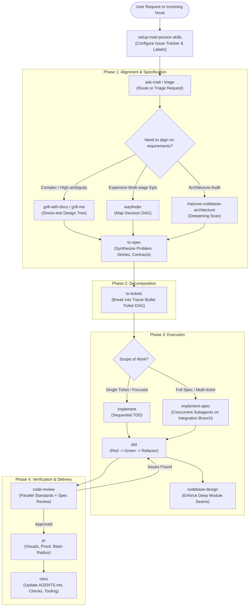
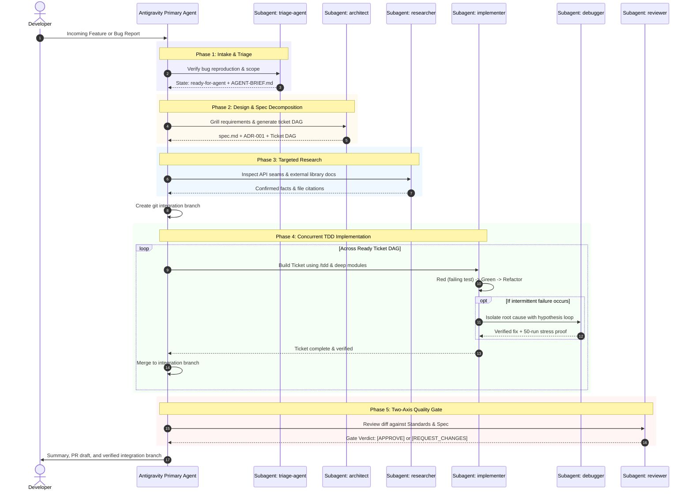

# Antigravity (agy) Skills Architecture & Illustration Guide

This guide illustrates the complete catalog of **27 engineering and productivity skills** integrated into this project from [mattpocock/skills](https://github.com/mattpocock/skills.git). All skills have been ported, curated, and optimized specifically for the **Google Antigravity (`agy`) / Gemini CLI** agent environment.

---

## Table of Contents

1. [Architectural Overview](#1-architectural-overview)
2. [The End-to-End Development Lifecycle](#2-the-end-to-end-development-lifecycle)
3. [Antigravity Subagent Orchestration](#3-antigravity-subagent-orchestration)
4. [Master Skill Directory](#4-master-skill-directory)
   - [Phase 1: Exploration, Alignment & Triage](#phase-1-exploration-alignment--triage)
   - [Phase 2: Specification & System Design](#phase-2-specification--system-design)
   - [Phase 3: Implementation & Test-Driven Development](#phase-3-implementation--test-driven-development)
   - [Phase 4: Review, Quality & PR](#phase-4-review-quality--pr)
   - [Phase 5: Productivity, Communication & Learning](#phase-5-productivity-communication--learning)
5. [In-Depth Skill Breakdown](#5-in-depth-skill-breakdown)
6. [Real-World Walkthrough Scenarios](#6-real-world-walkthrough-scenarios)
   - [Scenario A: Building a Feature from Scratch](#scenario-a-building-a-feature-from-scratch)
   - [Scenario B: Diagnosing and Fixing a Hard Bug](#scenario-b-diagnosing-and-fixing-a-hard-bug)
   - [Scenario C: Architectural Audit and Module Deepening](#scenario-c-architectural-audit-and-module-deepening)
   - [Scenario D: Context Handoff Across Sessions](#scenario-d-context-handoff-across-sessions)

---

## 1. Architectural Overview

In **Antigravity (`agy`)**, skills are modular packages of procedures, patterns, and runbooks located in the workspace under `.agents/skills/<skill-name>/SKILL.md`.

### Progressive Disclosure Model
Antigravity utilizes **progressive disclosure** to conserve context window tokens:
- **Index Stage**: Only the `name` and `description` frontmatter fields are visible in the agent's top-level context catalog.
- **Activation Stage**: When a skill is invoked (via user slash command or agent heuristic), the full content of `SKILL.md` and any referenced documents (such as `mocking.md`, `tests.md`, `DEEPENING.md`) are selectively read using `view_file`.

```
.agents/skills/
├── ask-matt/                       # Workflow router & navigator
├── code-review/                    # 2-axis code review (Standards + Spec)
├── codebase-design/                # Deep module philosophy & design-it-twice
├── diagnosing-bugs/                # 6-phase hypothesis & instrumentation loop
├── domain-modeling/                # Ubiquitous language, GLOSSARY.md & ADRs
├── grill-me/                       # Relentless decision-tree interview (general)
├── grill-with-docs/                # Grilling + inline ADR & glossary generation
├── handoff/                        # Cross-session context serialization
├── implement/                      # Single-ticket TDD implementation
├── implement-spec/                 # Multi-ticket task-graph branch execution
├── improve-codebase-architecture/  # Architectural scan & HTML candidate report
├── pr/                             # High-signal pull request formatter
├── prototype/                      # Throwaway logic & UI exploration
├── research/                       # Primary-source cited technical research
├── retro/                          # Post-session tooling & steering retro
├── setup-matt-pocock-skills/       # Project tracker & triage initialization
├── tdd/                            # Red-Green-Refactor vertical slice loop
├── teach/                          # Stateful tutoring & missions workspace
├── to-questionnaire/               # Async decision interview for third parties
├── to-spec/                        # Conversation-to-spec synthesizer
├── to-tickets/                     # Spec-to-DAG tracer-bullet decomposition
├── triage/                         # 5-state issue & PR triage engine
├── wait-what/                      # Plain-English re-pitching of unclear concepts
├── wayfinder/                      # Epic-scale fog-of-war navigation
├── wizard/                         # Interactive bash wizard for manual human tasks
└── writing-for-agents/             # Style guide for AGENTS.md & skill authoring
```

---

## 2. The End-to-End Development Lifecycle

The skills combine into a cohesive, disciplined engineering pipeline. Rather than "vibe coding", work proceeds through clear phase boundaries with explicit verification seams:



---

## 3. Antigravity Subagent Orchestration

Antigravity executes complex engineering workflows using autonomous specialized subagents, keeping the primary conversation context lean and focused.

### The 6 Specialized Subagents Roster

```
┌────────────────────────────────────────────────────────────────────────┐
│                        Primary Antigravity Agent                       │
└────┬────────────┬─────────────┬─────────────┬────────────┬─────────────┘
     │            │             │             │            │             │
     ▼            ▼             ▼             ▼            ▼             ▼
┌──────────┐ ┌──────────┐ ┌──────────┐ ┌───────────┐ ┌──────────┐ ┌──────────┐
│  triage  │ │architect │ │researcher│ │implementer│ │ debugger │ │ reviewer │
│  -agent  │ │          │ │          │ │           │ │          │ │          │
└──────────┘ └──────────┘ └──────────┘ └───────────┘ └──────────┘ └──────────┘
```

| Subagent | Type / Mode | Key Bound Skills | Primary Responsibility |
| :--- | :--- | :--- | :--- |
| **`triage-agent`** | Pre-Flight & Triage | `triage` | Ingests issues/PRs, runs reproduction scripts, and writes actionable briefs |
| **`architect`** | Design & Planning | `grill-with-docs`, `codebase-design`, `to-spec`, `to-tickets` | Eliminates tacit assumptions, records ADRs, specifies deep interfaces, and outputs ticket DAGs |
| **`researcher`** | Read-Only Discovery | `research` | Traces codebase execution paths and reads official documentation with source citations |
| **`implementer`** | TDD & Construction | `tdd`, `codebase-design` | Writes tests first (Red), implements minimal code (Green), and refactors across deep seams |
| **`debugger`** | Root-Cause Analysis | `diagnosing-bugs` | 6-phase scientific debugging loop for flaky tests, race conditions, and tricky defects |
| **`reviewer`** | Two-Axis Gatekeeper | `code-review` | Orthogonal review on Standards (patterns/smells) and Spec (acceptance/edge cases) with gate verdicts |

---

### End-to-End Subagent Interaction Sequence



---

### Detailed Agent Profiles & When to Use

#### 1. `triage-agent`
- **When to Use**: Whenever processing incoming GitHub/GitLab issues, user bug reports, or external PRs. Use it to determine reproducibility and filter noise before wasting engineering cycles.
- **Tools**: `view_file`, `grep_search`, `run_command`, `write_to_file`, `replace_file_content`.
- **Workflow**:
  ```
  Incoming Issue ──> Reproduce Script ──> State Evaluation ──> AGENT-BRIEF.md
  ```

#### 2. `architect`
- **When to Use**: When initiating new features, services, or multi-ticket refactors with ambiguous boundaries. Relentlessly grills assumptions and writes specifications.
- **Tools**: `view_file`, `grep_search`, `write_to_file`, `replace_file_content`, `run_command`.
- **Workflow**:
  ```
  Grilling Interview ──> GLOSSARY & ADRs ──> Deep Interfaces ──> Ticket DAG
  ```

#### 3. `researcher`
- **When to Use**: Read-only exploration before writing code. Locates entry points, analyzes cross-cutting call trees, and investigates external documentation.
- **Tools**: `view_file`, `grep_search`, `search_web`, `read_url_content`.
- **Workflow**:
  ```
  Research Goal ──> Codebase & Web Search ──> Call Graph Trace ──> Cited Findings
  ```

#### 4. `implementer`
- **When to Use**: Building single tickets or features where requirements and file ownership are clear. Follows strict test-driven development.
- **Tools**: `view_file`, `grep_search`, `replace_file_content`, `write_to_file`, `run_command`.
- **Workflow**:
  ```
  Scope Check ──> Failing Test (Red) ──> Smallest Code (Green) ──> Seam Refactor
  ```

#### 5. `debugger`
- **When to Use**: When tests are flaky, CI builds fail intermittently, or complex defects defy immediate inspection. Never relies on speculative fixes.
- **Tools**: `view_file`, `grep_search`, `replace_file_content`, `write_to_file`, `run_command`.
- **Workflow**:
  ```
  Automated Repro ──> Isolation ──> Hypotheses ──> Telemetry ──> Verified Fix
  ```

#### 6. `reviewer`
- **When to Use**: Prior to opening or merging pull requests, and after each implementer subagent completes a ticket.
- **Tools**: `view_file`, `grep_search`, `run_command`.
- **Workflow**:
  ```
  Diff Audit ──> Standards Axis + Spec Axis ──> Verification ──> Gate Verdict
  ```

---

## 4. Master Skill Directory

| Skill | Mode | Trigger / Command | Core Function |
| :--- | :--- | :--- | :--- |
| [`ask-matt`](.agents/skills/ask-matt/SKILL.md) | User | `/ask-matt` | Router to determine the best skill or workflow for any situation |
| [`setup-matt-pocock-skills`](.agents/skills/setup-matt-pocock-skills/SKILL.md) | User | `/setup-matt-pocock-skills` | Initializes issue tracker, triage labels, and domain doc structure |
| [`triage`](.agents/skills/triage/SKILL.md) | User | `/triage` | Categorizes and drives incoming issues/PRs through a 5-role state machine |
| [`wayfinder`](.agents/skills/wayfinder/SKILL.md) | User | `/wayfinder` | Maps large multi-session initiatives into decision DAGs behind a fog of war |
| [`grill-me`](.agents/skills/grill-me/SKILL.md) | User | `/grill-me` | Relentless questioning to eliminate assumptions from plans |
| [`grill-with-docs`](.agents/skills/grill-with-docs/SKILL.md) | User | `/grill-with-docs` | Code-focused grilling that creates `GLOSSARY.md` and ADRs inline |
| [`grilling`](.agents/skills/grilling/SKILL.md) | Model | Auto / internal | Underlying primitive for frontier-based multi-round decision questioning |
| [`domain-modeling`](.agents/skills/domain-modeling/SKILL.md) | Model | Auto / internal | Maintains ubiquitous language, glossary terms, and architectural decisions |
| [`to-spec`](.agents/skills/to-spec/SKILL.md) | User | `/to-spec` | Synthesizes current discussion into an actionable specification document |
| [`to-tickets`](.agents/skills/to-tickets/SKILL.md) | User | `/to-tickets` | Decomposes a spec into tracer-bullet tickets with blocking dependencies |
| [`implement`](.agents/skills/implement/SKILL.md) | User | `/implement` | Implements an individual ticket using TDD and closes with code review |
| [`implement-spec`](.agents/skills/implement-spec/SKILL.md) | User | `/implement-spec` | Coordinates subagents to build an entire spec DAG on an integration branch |
| [`tdd`](.agents/skills/tdd/SKILL.md) | Model | Auto / `/tdd` | Strict red-green-refactor loop across vertical slices |
| [`codebase-design`](.agents/skills/codebase-design/SKILL.md) | Model | Auto / internal | Principles for deep modules, narrow interfaces, and design-it-twice exploration |
| [`code-review`](.agents/skills/code-review/SKILL.md) | User / Model | `/code-review` | Two-axis audit: Standards (repo conventions) and Spec (requirements match) |
| [`diagnosing-bugs`](.agents/skills/diagnosing-bugs/SKILL.md) | User / Model | Auto / `/diagnosing-bugs` | 6-phase disciplined debugging: reproduce -> isolate -> hypothesise -> fix |
| [`improve-codebase-architecture`](.agents/skills/improve-codebase-architecture/SKILL.md) | User | `/improve-codebase-architecture` | Generates visual HTML report of shallow modules and refactoring candidates |
| [`prototype`](.agents/skills/prototype/SKILL.md) | Model | Auto / internal | Fast throwaway single-file HTML or logic sketches to test assumptions |
| [`research`](.agents/skills/research/SKILL.md) | Model | Auto / internal | Deep-dive primary source and documentation research saved to repo |
| [`pr`](.agents/skills/pr/SKILL.md) | User / Model | Auto / `/pr` | Formats high-clarity PR descriptions with proof, diffs, and blast radius |
| [`retro`](.agents/skills/retro/SKILL.md) | User | `/retro` | Evaluates coding session to improve `AGENTS.md`, tooling, and linting |
| [`wizard`](.agents/skills/wizard/SKILL.md) | Model | Auto / internal | Generates interactive bash scripts for manual human-only tasks (cloud, secrets) |
| [`handoff`](.agents/skills/handoff/SKILL.md) | User | `/handoff` | Serializes state into a structured handoff document for the next session |
| [`teach`](.agents/skills/teach/SKILL.md) | User | `/teach` | Stateful tutoring environment with interactive missions and learning records |
| [`to-questionnaire`](.agents/skills/to-questionnaire/SKILL.md) | User | `/to-questionnaire` | Generates an async Markdown questionnaire for third-party decision makers |
| [`wait-what`](.agents/skills/wait-what/SKILL.md) | User | `/wait-what` | Resets and re-explains confusing messages in plain English using glossary terms |
| [`writing-for-agents`](.agents/skills/writing-for-agents/SKILL.md) | Model | Auto / internal | Style guide for writing instructions, skills, and documentation for AI |

---

## 5. In-Depth Skill Breakdown

### Phase 1: Exploration, Alignment & Triage

#### `ask-matt`
- **What it does**: Acts as a central router over all installed skills. When you don't know what skill to reach for or how to structure an ambiguous challenge, `ask-matt` analyzes your situation against phase boundaries and directs you to the optimal workflow.
- **Trigger**: `/ask-matt` or *"What skill should I use for this?"*
- **Key Resources**: [`PHASE-BOUNDARIES.md`](.agents/skills/ask-matt/PHASE-BOUNDARIES.md)

#### `setup-matt-pocock-skills`
- **What it does**: Configures the repo's tracking infrastructure. It queries your preferences for issue tracking (GitHub Issues via `gh`, GitLab via `glab`, or local markdown files in `.scratch/`), sets up triage label standards, and defines domain doc storage (`GLOSSARY.md` and `docs/adr/`).
- **Trigger**: `/setup-matt-pocock-skills` (run once per repository).

#### `triage`
- **What it does**: Operates a state machine for incoming issues and external PRs. Moves items through canonical stages: `needs-triage` -> `needs-info` -> `ready-for-agent` / `ready-for-human` / `wontfix`. Produces actionable, context-rich agent briefs.
- **Trigger**: `/triage` or *"Triage open issues"*.
- **Key Resources**: [`AGENT-BRIEF.md`](.agents/skills/triage/AGENT-BRIEF.md), [`OUT-OF-SCOPE.md`](.agents/skills/triage/OUT-OF-SCOPE.md)

#### `grill-me` & `grill-with-docs`
- **What they do**: Prevents the #1 failure mode in agentic development: building the wrong thing due to tacit assumptions.
  - `grill-me`: Conducts a relentless multi-round interview mapping your idea as a branching decision tree. Every question includes a recommended default.
  - `grill-with-docs`: Adds engineering domain capture: extracts domain terminology into `GLOSSARY.md` and records technical decisions into `docs/adr/XXXX-title.md` as they settle.
- **Trigger**: `/grill-me` or `/grill-with-docs`.

---

### Phase 2: Specification & System Design

#### `to-spec`
- **What it does**: Takes the consensus from a conversation or grilling session and synthesizes it into an official specification—without asking repetitive questions. Generates Problem Statement, Solution, exhaustive numbered User Stories, Implementation Decisions (without fragile file paths), and Testing Decisions.
- **Trigger**: `/to-spec` or *"Turn this discussion into a spec"*.

#### `to-tickets`
- **What it does**: Decomposes a specification into a directed acyclic graph (DAG) of tracer-bullet tickets. Each ticket has explicit blocking dependencies (`Blocked by #...`) and clear acceptance criteria. Works with GitHub/GitLab issues or local files in `.scratch/<feature>/`.
- **Trigger**: `/to-tickets` or *"Break the spec down into tickets"*.

#### `codebase-design`
- **What it does**: Embeds John Ousterhout's *Philosophy of Software Design* principles: designing **deep modules** (hiding significant complexity behind a small, simple interface) placed at clean architectural seams. Includes the "Design It Twice" pattern to explore alternative interface contracts.
- **Trigger**: Model-invoked during architectural planning or interface creation.
- **Key Resources**: [`DEEPENING.md`](.agents/skills/codebase-design/DEEPENING.md), [`DESIGN-IT-TWICE.md`](.agents/skills/codebase-design/DESIGN-IT-TWICE.md)

---

### Phase 3: Implementation & Test-Driven Development

#### `implement` & `implement-spec`
- **What they do**:
  - `implement`: Implements a single ticket or task using test-driven development at pre-agreed seams, followed by a code review.
  - `implement-spec`: High-concurrency orchestrator. Creates a git integration branch, traverses the ticket task graph, launches Antigravity `implementer` subagents in parallel across unblocked tickets, merges them, and runs automated verification.
- **Trigger**: `/implement` or `/implement-spec`.

#### `tdd`
- **What it does**: Enforces genuine Test-Driven Development via strict Red-Green-Refactor cycles across vertical slices. Discourages mock overuse, focuses on testing through high-level interfaces, and insists on running and verifying real test output before touching production code.
- **Trigger**: Model-invoked whenever writing or modifying code; or `/tdd`.
- **Key Resources**: [`tests.md`](.agents/skills/tdd/tests.md), [`mocking.md`](.agents/skills/tdd/mocking.md)

#### `diagnosing-bugs`
- **What it does**: A structured 6-phase loop for hard, flaky, or performance-related bugs:
  1. Reproduce with an automated test
  2. Minimize reproduction surface
  3. Formulate falsifiable hypotheses
  4. Instrument with targeted telemetry
  5. Apply the minimal fix
  6. Verify regression tests
- **Trigger**: `/diagnosing-bugs` or whenever diagnosing an issue.
- **Key Resources**: [`scripts/hitl-loop.template.sh`](.agents/skills/diagnosing-bugs/scripts/hitl-loop.template.sh)

---

### Phase 4: Review, Quality & PR

#### `code-review`
- **What it does**: Conducts an independent two-axis review of git diffs:
  - **Standards Axis**: Verifies adherence to repository coding conventions, formatting, architecture patterns, and anti-patterns (Fowler smells).
  - **Spec Axis**: Verifies that the implementation strictly satisfies the originating requirements, handles edge cases, and has complete test coverage.
- **Trigger**: `/code-review` or automatic review prior to pull requests.

#### `pr`
- **What it does**: Formats production-grade PR bodies: provides a visual representation (Mermaid chart, table, or UI screenshot), reproducible proof of verification, and a merge-danger evaluation (blast radius, one-way vs. two-way door decisions).
- **Trigger**: `/pr` or *"Draft PR body"*.

#### `retro`
- **What it does**: Post-session retrospective. Analyzes where the agent encountered friction (slow file searches, failed tool calls, missing lint checks, unwieldy rules) and outputs actionable proposals to enhance `AGENTS.md` and automated repository checks.
- **Trigger**: `/retro`.

---

### Phase 5: Productivity, Communication & Learning

#### `teach`
- **What it does**: Transforms Antigravity into an interactive mentor. Creates a stateful workspace in the repository, delivering bite-sized challenges, evaluating code solutions, updating a learner's `LEARNING-RECORD.md`, and building domain knowledge.
- **Trigger**: `/teach <topic>` (e.g. `/teach AST transformations in TypeScript`).
- **Key Resources**: [`MISSION-FORMAT.md`](.agents/skills/teach/MISSION-FORMAT.md), [`LEARNING-RECORD-FORMAT.md`](.agents/skills/teach/LEARNING-RECORD-FORMAT.md)

#### `handoff`
- **What it does**: When a session reaches its context limit or needs to transition to a different machine, developer, or agent harness, `handoff` serializes the active state, decisions, completed steps, and blockers into an actionable handoff markdown file.
- **Trigger**: `/handoff`.

#### `to-questionnaire`
- **What it does**: When an architectural or product decision depends on a human stakeholder (e.g., product manager or security engineer), it generates an asynchronous Markdown questionnaire with context, specific questions, and tradeoffs.
- **Trigger**: `/to-questionnaire`.

#### `wait-what`
- **What it does**: The circuit breaker for confusion. Whenever the agent produces an overly complex, jargon-heavy explanation, typing `/wait-what` forces the agent to stop, discard unnecessary details, and re-explain in plain English using canonical project terms.
- **Trigger**: `/wait-what` or *"Wait what?"*.

---

## 6. Real-World Walkthrough Scenarios

### Scenario A: Building a Feature from Scratch

```
Developer: /grill-with-docs "We need an idempotent Webhook Ingestion service for Stripe events"
```

1. **Grilling Turn**: Antigravity questions you in rounds:
   - *Q1: What datastore will deduplicate event IDs?* -> Default: Redis with TTL.
   - *Q2: How do we handle signature verification failures?* -> Default: Return 400 immediately and drop event.
2. **Domain Capture**: Automatically writes `docs/adr/0003-redis-webhook-dedup.md` and registers terms in `GLOSSARY.md`.
3. **Specification**: You type `/to-spec`. Antigravity creates `.scratch/webhook-ingestion/spec.md` with numbered user stories and interface contracts.
4. **Ticket Graph**: You type `/to-tickets`. Antigravity generates tickets `001-payload-signature-validator.md`, `002-redis-dedup-store.md`, `003-event-dispatcher.md` with dependency relationships.
5. **Implementation**: You type `/implement-spec`.
   - Antigravity creates branch `feat/webhook-ingestion`.
   - Spawns `implementer` subagents to write unit tests first (`tdd`) and fulfill contracts.
   - Merges completed tickets into the integration branch.
6. **Review**: Runs `/code-review` via an independent `reviewer` subagent.
7. **Pull Request**: Runs `/pr` to generate a high-signal PR ready for merge.

---

### Scenario B: Diagnosing and Fixing a Hard Bug

```
Developer: /diagnosing-bugs "The background sync intermittently crashes with a ConnectionResetError in CI"
```

1. **Phase 1 (Reproduce)**: Antigravity writes a test simulating network socket drops. Runs the test until it reliably fails (Red).
2. **Phase 2 (Isolate)**: Antigravity strips away extraneous middleware to isolate the offending network client call.
3. **Phase 3 (Hypothesize)**: Proposes three testable hypotheses (e.g., stale keep-alive connection pool, missing retry logic, thread starvation).
4. **Phase 4 (Instrument)**: Adds non-invasive logging / debug counters to the connection lifecycle.
5. **Phase 5 (Fix)**: Implements exponential backoff with jitter and connection recycling.
6. **Phase 6 (Verify)**: Runs test suite 50 times in a loop to ensure 0 flakes. Closes with a targeted diff.

---

### Scenario C: Architectural Audit and Module Deepening

```
Developer: /improve-codebase-architecture
```

1. **Codebase Scan**: Antigravity analyzes directory boundaries, imports, and function complexity.
2. **HTML Report**: Produces `docs/architecture-report.html` highlighting "shallow" modules (large interfaces with little internal complexity) and candidate seams for consolidation.
3. **Design Discussion**: Antigravity grills through candidate #1 using `codebase-design` principles.
4. **Refactor**: Spawns an `implementer` subagent using the "Design It Twice" pattern to implement the deeper module behind an adapter seam.

---

### Scenario D: Context Handoff Across Sessions

```
Developer: /handoff "Switching off for the evening; tomorrow we connect the Redis dedup service to the database"
```

1. **State Snapshot**: Antigravity analyzes the conversation context, recent git commits, and unfinished tasks.
2. **Output Document**: Writes `.scratch/handoffs/2026-10-16-webhook-progress.md` with:
   - What was accomplished today (with commit hashes)
   - Decisions finalized (pointing to ADR 0003)
   - Current blockers and unsettled questions
   - First 3 concrete commands/actions for the next session
3. **Next Session**: Simply point the next agent: *"Resume from `.scratch/handoffs/2026-10-16-webhook-progress.md`"*.

---

*All skills are maintained under `.agents/skills/` and are fully ready to use.*
